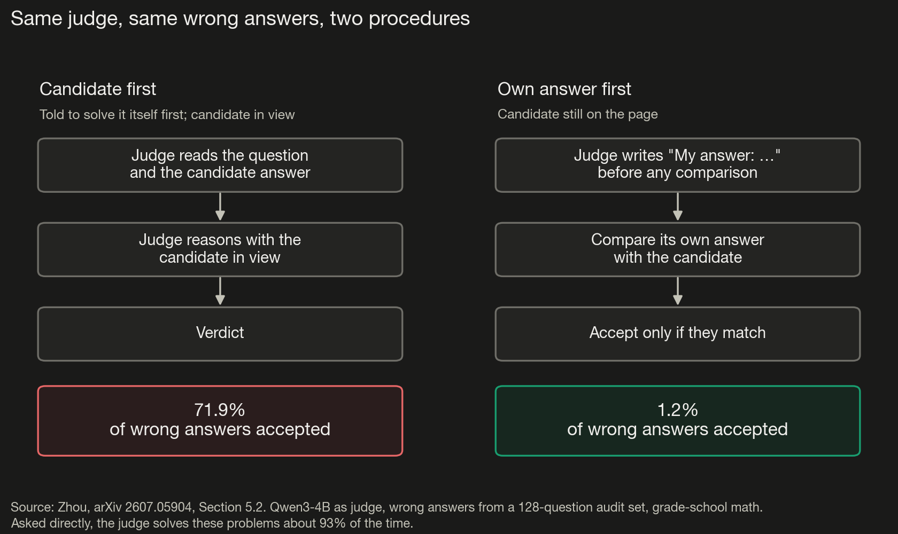
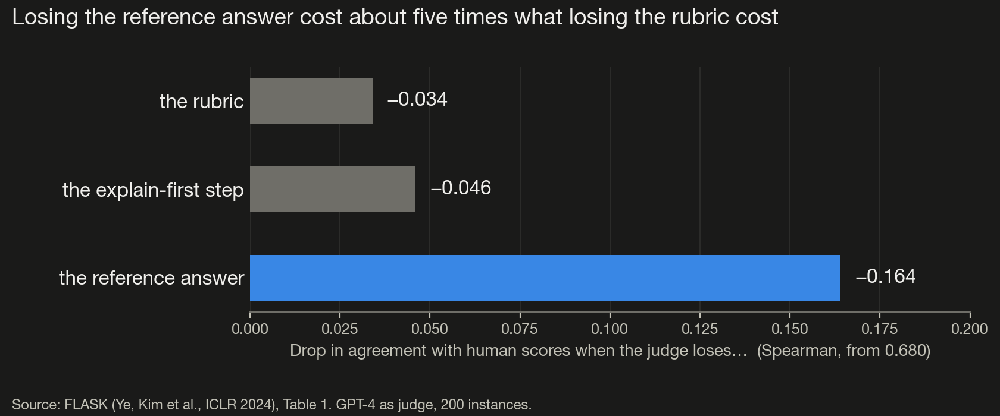
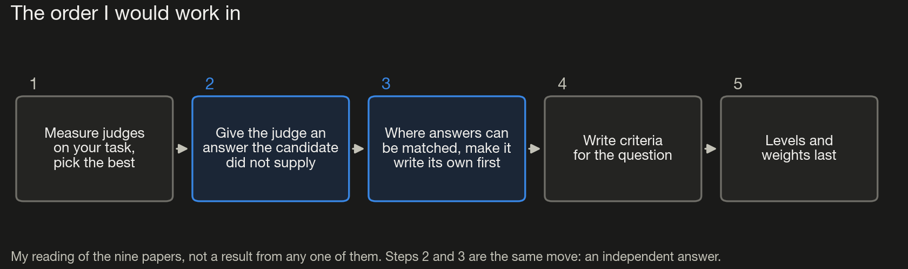

*Cover photo by [Tingey Injury Law Firm](https://unsplash.com/@tingeyinjurylawfirm?utm_source=unsplash&utm_medium=referral&utm_content=creditCopyText) on [Unsplash](https://unsplash.com/photos/woman-holding-sword-statue-during-daytime-DZpc4UY8ZtY?utm_source=unsplash&utm_medium=referral&utm_content=creditCopyText).*

When an LLM judge gives scores you don't trust, the usual fix is to rework the rubric: add levels, split it into dimensions, weight the criteria.

A judge that reads the candidate answer first ends up checking how the answer looks. To check whether it is right, the judge needs an answer that did not come from the candidate: a reference answer, or its own answer written before it scores. That one change moves a judge more than reworking levels, labels or weights.

In one study ([Zhou, 2026](https://arxiv.org/abs/2607.05904)) the same judge accepted 71.9% of wrong answers when it reasoned with the candidate in view, and 1.2% when it wrote its own answer first.

*The same judge model graded the same wrong answers under two procedures. From Zhou (2026).*

## A judge follows the answer it is shown

[MT-Bench](https://arxiv.org/abs/2306.05685) reported that GPT-4, used as a judge, failed to grade basic math problems that it could solve when asked directly. Shown a wrong answer, it was misled by it. In 20 judgments it passed the wrong answer 14 times. Asked to reason step by step first, it passed it 6 times. Given its own answer to compare against, written in a separate call, it passed it 3 times.

A [2026 paper by Zhou](https://arxiv.org/abs/2607.05904) tested the same idea against a model trained to win the judge's approval. The model was trained on grade-school math with its reasoning restricted, so most of its answers were wrong. After training, its wrong answers were more convincing, not fewer. The judge then graded the wrong answers from a 128-question audit set in two ways:

- Told to solve the problem itself before scoring, but with the candidate in view while it reasoned, it accepted 71.9%.
- Made to write "My answer:" before any comparison, with the candidate still on the page, and to accept only if the two matched, it accepted 1.2%.

Asked directly, the same judge solved these problems about 93% of the time. It had the ability. It did not use it while a convincing answer was in front of it.

A bigger judge did not fix this. A judge 3.5 times the size of the trained model still accepted 77% of its wrong answers, and a panel that required three judge families to agree still accepted 55%.

The paper states three limits. The result is from a 128-question audit set in grade-school math. The method needs an answer that can be matched exactly. And it hurts a judge that cannot solve the task: on a code benchmark, writing its own solution first made a 1.7B judge worse and an 8B judge better.

The paper also gives a check you can run. A judge that really writes its own answer first can pass a wrong answer only when it makes the same mistake, so its false-pass rate (the share of wrong answers it passes) cannot be higher than its own error rate. If it is, the shown answer is leaking into its reasoning.

## A reference answer is the same move

[FLASK](https://arxiv.org/abs/2307.10928) gave a GPT-4 judge four things: the instruction, a reference answer, the response, and a rubric, and asked it to explain before scoring. It then removed one part at a time and measured how well the judge's scores tracked human scores on 200 instances, as Spearman correlation (rank agreement; 1.0 is the same ordering). With everything, the correlation was 0.680. Without the rubric, 0.646. Without the reference answer, 0.516.

*What each part of the judge's prompt was worth. From FLASK, Table 1.*

[Rubrics as Rewards](https://arxiv.org/abs/2507.17746) used judges as a training reward. A 7B model was trained with four kinds of judge and scored on a medical benchmark (0 to 100):

- Plain rating, judge sees no reference: 23.9
- Plain rating, judge sees the reference answer: 31.7
- Rubric written for the question, without the reference: 32.0
- Rubric written for the question, from the reference: 35.9

These are single runs with no error bars, and the same judge model also graded the benchmark, so treat the gaps as rough.

[DR Tulu](https://arxiv.org/abs/2511.19399) gave its rubric writer search results for each question. The share of criteria that made a concrete, checkable claim rose from 0.22 to 0.56. The downstream gain was about one point on the paper's benchmark average.

These are one idea, and the same idea as the section above. A reference answer, retrieved evidence, and the judge's own answer written first all put something on the judge's side that the candidate did not supply. The independent answer does not have to be a gold answer. The three have not been tested against each other, and the results for judges used in evaluation and judges used as a training reward come from separate studies.

## How this compares with reworking the rubric

In FLASK, replacing one overall score with a levelled rubric per skill raised agreement with humans by 0.04 to 0.08 across three judges. Swapping the judge from GPT-3.5 to GPT-4 raised it by 0.26 to 0.28.

In Rubrics as Rewards, deleting the importance labels from the rubric raised the score (38.8 against 37.2), and deleting every "must not" criterion changed nothing (37.2 both ways). A [review of higher-education studies](https://www.frontiersin.org/journals/education/articles/10.3389/feduc.2018.00022/full) found the same for human students: all 13 studies it counted reported positive effects, whether the rubric's levels described the work (8) or only judged it (5).

What the rubric says does matter. In Rubrics as Rewards, one generic rubric applied to every question trained a worse model than a plain rating with no rubric, 12.5 against 25.5 (on a different evaluation set from the list above). And in that list, a rubric written for the question was worth about as much as the reference answer.

So levels, labels and weights are the last thing to work on. What the criteria say, and whether the judge has an independent answer, come first. The numbers on rubric form are single results from one study, so this part is the least settled.

## What this does not fix

For a research report or an essay there is no single answer to write first. The one result here on open-ended grading is weaker: [GLIDER](https://arxiv.org/abs/2412.14140) trained a small judge to list its evidence before scoring, and its average correlation with humans rose from 0.480 to 0.534 against the same judge trained without that step.

And a judge with an independent answer is still marking against a list. A [study of rubric-based RL](https://arxiv.org/abs/2605.12474) trained a model against a strong judge that agreed with a panel of three other models 92% of the time. Shown the rubric, the panel preferred the trained model on 85.8% of prompts. With the rubric hidden, it preferred the untrained model on 78.4%. That is one run.

The judge read the rubric well, and the rubric was not the whole of a good answer.

## The order I would work in

1. Measure candidate judges on your own task and pick the best. In FLASK the judge swap was the largest single effect, and in [HealthBench](https://cdn.openai.com/pdf/bd7a39d5-9e9f-47b3-903c-8b847ca650c7/healthbench_paper.pdf) the model that answered best was not the best grader: on agreement with physicians, o3 scored 0.681 and GPT-4.1 scored 0.709, though the grader prompt had been tuned on GPT-4.1.
2. Give the judge an answer the candidate did not supply: a reference answer or retrieved evidence.
3. Where answers can be matched exactly, make the judge write its own answer first.
4. Write criteria for the question.
5. Leave levels and weights for last.

*Steps 2 and 3 are the point of this post.*

## What is not settled

No single study compares all of these. FLASK compares judge, reference and rubric in one table, for evaluation only. In the training results the measured effects run from about one point to about thirteen, each from a single run.

And there is the task with no answer key. What does "write your own answer first" mean when the task is a research report, and the judge's own attempt is just another sample?

## References

1. Zheng et al., *Judging LLM-as-a-Judge with MT-Bench and Chatbot Arena*, NeurIPS 2023. https://arxiv.org/abs/2306.05685
2. Zhou, *More Convincing, Not More Correct: Self-Play Reward Hacking of Reference-Free LLM Judges*, 2026. https://arxiv.org/abs/2607.05904
3. Ye, Kim et al., *FLASK: Fine-grained Language Model Evaluation based on Alignment Skill Sets*, ICLR 2024. https://arxiv.org/abs/2307.10928
4. Gunjal et al., *Rubrics as Rewards: Reinforcement Learning Beyond Verifiable Domains*, 2025. https://arxiv.org/abs/2507.17746
5. Shao, Asai, Shen, Ivison et al., *DR Tulu: Reinforcement Learning with Evolving Rubrics for Deep Research*, ICML 2026. https://arxiv.org/abs/2511.19399
6. Brookhart, *Appropriate Criteria: Key to Effective Rubrics*, Frontiers in Education, 2018. https://www.frontiersin.org/journals/education/articles/10.3389/feduc.2018.00022/full
7. Deshpande et al., *GLIDER: Grading LLM Interactions and Decisions using Explainable Ranking*, 2024. https://arxiv.org/abs/2412.14140
8. Mahmoud, Rezaei, Wang, Gunjal, Liu, He, *Reward Hacking in Rubric-Based Reinforcement Learning*, 2026. https://arxiv.org/abs/2605.12474
9. Arora, Wei et al., *HealthBench: Evaluating Large Language Models Towards Improved Human Health*, OpenAI, 2025. https://cdn.openai.com/pdf/bd7a39d5-9e9f-47b3-903c-8b847ca650c7/healthbench_paper.pdf
