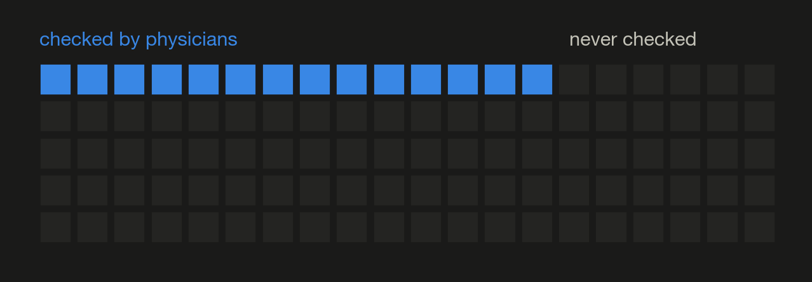
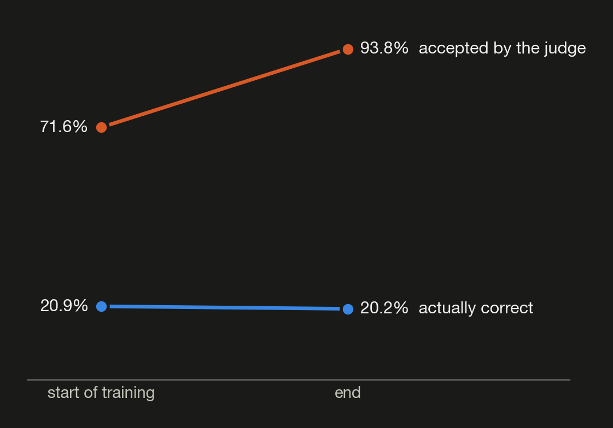
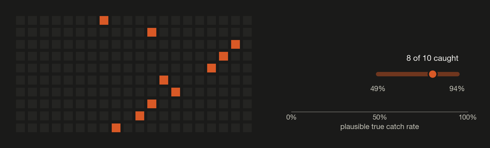
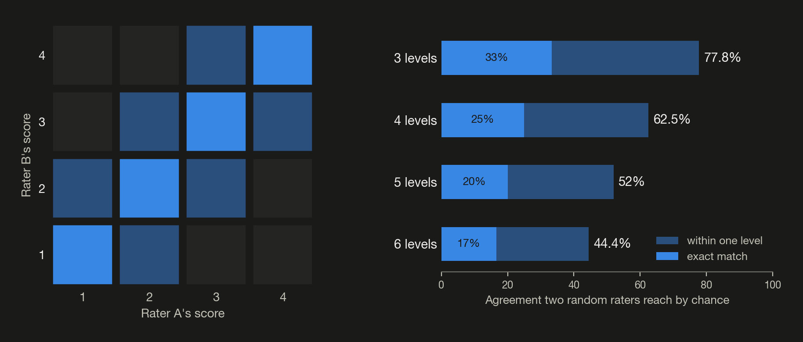
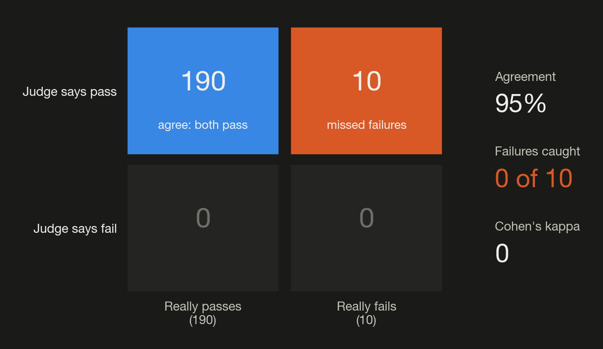
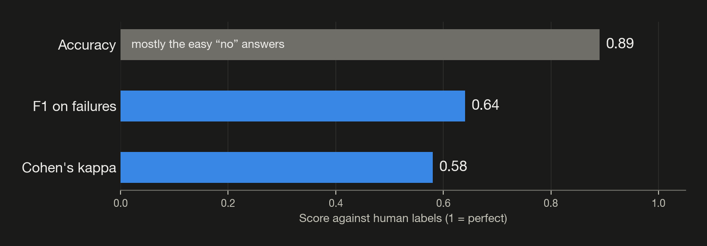
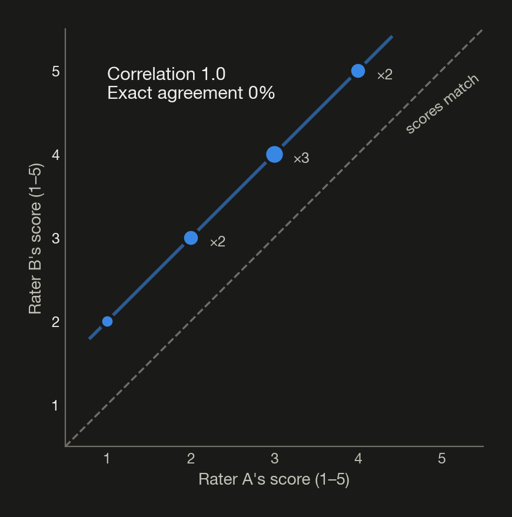
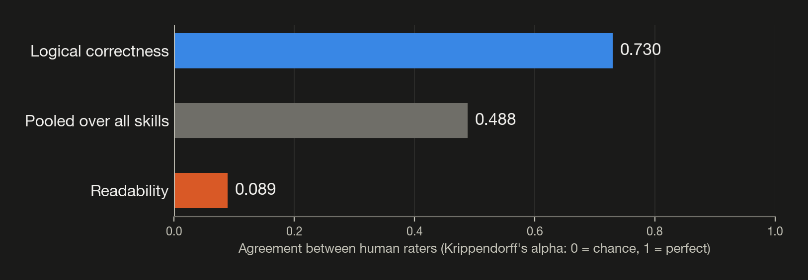
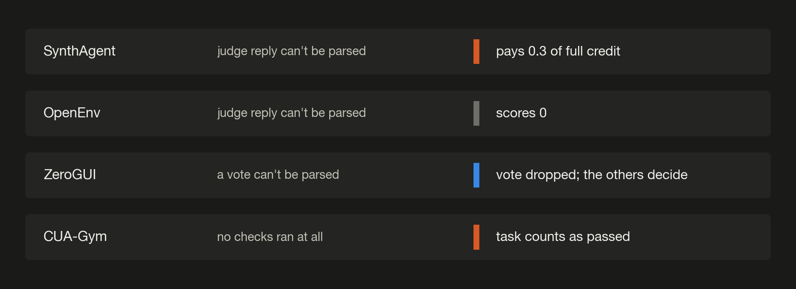
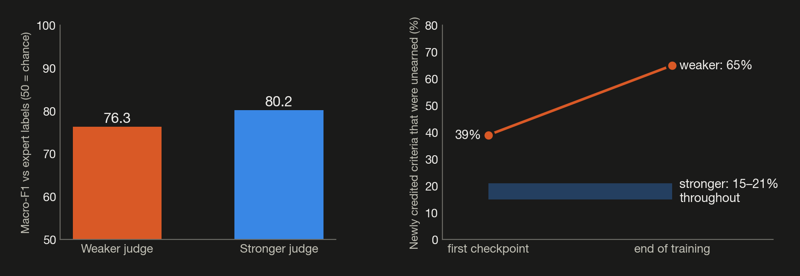

*Cover image by [TheDigitalArtist](https://pixabay.com/users/thedigitalartist-202249/?utm_source=link-attribution&utm_medium=referral&utm_campaign=image&utm_content=1726357) from [Pixabay](https://pixabay.com//?utm_source=link-attribution&utm_medium=referral&utm_campaign=image&utm_content=1726357).*

A judge that agrees with humans 94% of the time can still be a judge you should not train against.

Here is the judge this post follows. It reads an agent's trace and says pass or fail. In your data, 1 trace in 20 really fails. You label 200 random traces yourself and compare:

- 190 traces really pass. The judge passes 180 of them and wrongly fails 10.
- 10 traces really fail. The judge catches 8 and passes 2.

It agrees with you on 188 of 200 traces, 94%. Now compare a judge that never reads anything and says "pass" every time. It agrees on all 190 passing traces and misses all 10 failures: 95%. The lazy judge scores higher than yours. The 94% was earned almost entirely on the easy cases, and it says very little about the 10 cases where the reward actually has to decide something.

A single agreement number hides three questions:

1. **Where did you check the judge?** On the cases that are easy to label, or on the ones the reward pays for?
2. **Which number did you report?** One that rewards agreeing on the easy cases, or one that shows how the judge does on the cases that matter?
3. **Is the judge you checked the one that runs?** In training, the judge's reply goes through code that turns it into a reward. Did you check that code?

The answer to all three is one rule: **check the judge the way the reward will use it.**

*This is part 2 of 3. [Part 1]() covered what the judge should compare against.*

## Where did you check the judge?

Checking a judge against human labels is called "meta-evaluation", grading the grader. The result depends on which of the judge's decisions you chose to label. Think of testing a smoke detector by holding it in a room with no smoke. It is right every time, and you learn nothing about fires.

### The easy cases get checked

[HealthBench](https://cdn.openai.com/pdf/bd7a39d5-9e9f-47b3-903c-8b847ca650c7/healthbench_paper.pdf) is one of the most carefully built rubric benchmarks there is. Every medical conversation in it comes with criteria a good response should meet, and an LLM grader decides whether a response meets each one. To check the grader, physicians labelled about 60,000 of its decisions.

All of those decisions were on 34 general criteria that many conversations share and most physicians agreed on. Of all the criterion checks the grader makes, 14% use one of those 34. The other 86% use criteria written for one specific conversation by one physician, and none of the grader's decisions on them were checked. The part that was checked is the part where the right answer is clearest.

*Each square is 1% of the criterion checks HealthBench's grader makes. Physicians checked the grader only on the blue 14%. Source: HealthBench.*

### Where judges are checked on harder cases, the errors are large

[Agent-as-a-Judge](https://arxiv.org/abs/2410.10934) checked judges on harder material: coding agents given tasks with lists of requirements, where both an LLM judge and human experts marked what was done. Grading one agent, a judge said 7.27% of the tasks were fully solved. The humans said 1.81%. As a reward, that judge would have paid for four times as many solved tasks as there were. Grading another agent, a judge made the opposite mistake, crediting 12.56% of requirements where humans credited 44.80%. Errors this size do not show up in an agreement number dominated by easy cases.

### Training moves the policy toward the judge's mistakes

There is a second reason a random sample misleads: in RL, the sample does not stay random. A policy in training is searching for whatever the judge accepts. Every wrong answer the judge would accept is a direction the policy can move in.

[Zhou's](https://arxiv.org/abs/2607.05904) study shows this happening. A small model was trained on grade-school math to win an LLM judge's approval. Its reasoning was cut short on purpose, so most of its answers were wrong, which makes it a clean test of whether the judge would accept them. Two numbers were tracked during training: how many of its answers the judge accepted, and how many were actually correct.

*Over training, the judge accepted more and more of the model's answers while the share that were correct did not move. Source: Zhou (2026).*

Nearly every answer the judge newly accepted was wrong. The model did not learn math; it learned what the judge accepts. A check done at the start of training, on the model's early answers, says nothing about the answers it produces at the end.

### Check the decisions that create reward

So the decisions worth checking are the ones the reward is paying for, as training goes. The [rubric-hacking study](https://arxiv.org/abs/2605.12474) did exactly that during RL on medical questions. At each checkpoint it took only the rubric criteria the training judge had *newly* started crediting, and had them re-graded by a panel of three stronger judges. That panel is not just another opinion: it was itself checked against expert labels, and agreed with them better than the weaker training judge did.

With the weaker training judge, 39% of the newly credited criteria were unearned at the very first checkpoint, before training had changed much. By the end, 65% were. A random sample of all the judge's decisions would have buried that 39% under thousands of easy, correct ones.

> **Do this: check the decisions that create new reward, during training.** At every checkpoint, record the judge's verdict on each criterion for a fixed set of prompts. The verdicts that flipped from "not met" to "met" since the last checkpoint are where new reward comes from. Send a sample of those, not a random sample, to people or to a grader you have checked against people, and track the share they reject. That share is the number to watch.

### How many labels you need

What you need to know is how the judge does on the rare outcome, the failures. The running judge was checked on 10 of them. It caught 8. With only 10 cases, a true catch rate anywhere from about half to almost all would produce a result like that.

*Left: 200 random traces, 10 of them failures. Right: the range of true catch rates consistent with catching 8 of those 10 (a standard 95% interval for a proportion).*

To pin a catch rate to within about 10 points either way, you need around 100 failures. At a 5% failure rate that means labelling about 2,000 random traces.

> **Do this: sample the judge's passes and fails separately.** Instead of 2,000 random traces, label 100 traces the judge passed and 100 it failed. From the passed batch you learn how many failures slip through; from the failed batch, how many good traces it rejects. To turn these into rates for your whole data, weight each batch by how often the judge says pass or fail overall (here 182 of 200 and 18 of 200).

### Which mistake to fear

A judge can be wrong two ways: fail a good response, or pass a bad one. For a reward, passing a bad one is worse, because a false pass is paid, and the policy learns to produce more of whatever was paid. [ZeroGUI](https://arxiv.org/abs/2505.23762) trained the same computer-use agent with different judges. The agent trained best (27.2% task success) with the judge whose "success" calls were most often right (61.5% of them). The judge that caught the most real successes (74.5% of them), but whose "success" calls were right only 44.3% of the time, trained the agent to 24.0%. These are single runs with small gaps, but they point the same way as everything above.

> **Do this: when choosing between judges, prefer the one with fewer false passes,** even if it misses some real successes. A missed success costs you some signal; a false pass teaches the policy the wrong thing.

If some tasks have exact answers, you can watch for false passes during training almost for free. Mix a few of those tasks into every batch, give the judge the task but not the answer (otherwise it is checking a lookup, not judging), and compare its verdicts with the known answers. Track one number: the share of right answers it accepts minus the share of wrong answers it accepts. 1 means it separates them perfectly; 0 means it is no better than a coin flip. In Zhou's study it started at 0.31 and fell to 0.06.

> **Do this: keep a hidden answer key in every batch.** If that number falls well below where it started (say, by half), stop and re-check the judge on a fresh sample of newly credited decisions before training further.

It can be done well. [ARE](https://arxiv.org/abs/2509.17158) hand-labelled 450 agent trajectories and reported how often its verifier's passes were right: 53% when one LLM read the whole trajectory in a single prompt, and 99% for a structured verifier using the same model, which settles in code everything code can check (tool-call counts, exact IDs, ordering) and asks the LLM only about the rest.

## Which number did you report?

Even on the right cases, the number you report can make the same judge look good or bad. Each common statistic answers a different question, and each has a blind spot.

**Percent agreement asks: how often did two raters give the same score?** Its blind spot is that some agreement comes free. If two raters pick scores at random on a 4-level scale, they land within one level of each other 62.5% of the time without reading anything. Rubric studies still often report "agreement within one level". One set of ratings in [Brookhart's](https://www.frontiersin.org/journals/education/articles/10.3389/feduc.2018.00022/full) review scored 0.37 on exact agreement and 0.90 within one level. Same ratings, very different verdicts.

*Left: two raters choosing scores at random on a 4-level scale; shaded squares count as agreement within one level, 10 of 16. Right: the same free agreement for scales of 3 to 6 levels.*

**Cohen's kappa asks: how much better than luck is the agreement?** It works out how often two raters would agree by luck, given how often each uses each label, and measures how far above that they are. 1 is perfect; 0 is no better than luck. Applied to the lazy judge that always says "pass": against labels that are 95% "pass", it agrees 95% of the time by luck alone, so its kappa is exactly 0. The running judge, at 94% agreement, has a kappa of 0.54. Use kappa whenever one label is much more common than the other, which in judging is nearly always.

*The lazy judge on the same 200 traces. Every verdict is "pass", so all 10 failures are missed, and the 95% agreement is exactly what luck would give.*

**Precision and recall ask: how good is the judge at the thing it exists to find?** Pick the label you care about, say "fail". Precision is the share of the judge's "fail" calls that really were failures. Recall is the share of real failures it caught. F1 combines the two into one number. The judge in [MAST](https://arxiv.org/abs/2503.13657), which reads multi-agent traces and answers yes or no for each of 14 kinds of failure, shows why this matters. Most of its answers are "no, this did not happen", and those are easy. Against human labels it is right 89% of the time. On the failures themselves its F1 is 0.64, and its kappa is 0.58.

*The same judge on the same run. Accuracy counts the easy "no" answers; F1 and kappa do not. Source: MAST.*

**Correlation asks: do two raters' scores rise and fall together?** That is not the same as giving the same scores. A rater who scores every item exactly one point higher than another has a perfect correlation of 1.0 and never gives the same score once. Use correlation when you only need the judge to rank responses in the right order. Do not use it when the actual value matters: when the reward has a pass threshold, or is added to other reward terms, a constant offset changes what gets paid. (If your trainer only compares responses within a group, as GRPO does, a constant offset mostly cancels out.)

*Rater B scores every item one point above rater A. The points sit on a perfect line, and never on the dashed diagonal where the scores match.*

**Krippendorff's alpha asks the kappa question for any number of raters, and can respect the order of a scale.** Use it when you have more than two raters, some items with missing labels, or scores on an ordered scale. Two things go wrong in practice:

- **Pooling hides weak dimensions.** In [FLASK](https://arxiv.org/abs/2307.10928), three human raters scored 200 responses on several skills. Their pooled alpha was 0.488, which hid readability at 0.089, barely above luck.
- **The scale type changes the answer.** Four pathologists scoring 50 biopsies on a 10-level scale, reported by [Zapf and colleagues](https://www.ncbi.nlm.nih.gov/pmc/articles/PMC4974794/), had an alpha of 0.20 when every disagreement counted the same ("nominal") and 0.81 when a one-level miss counted as smaller than a nine-level miss ("ordinal"). For ordered scores, use ordinal alpha, or the two-rater version, weighted kappa.

*Agreement between human raters in FLASK. The pooled number hides a skill where humans barely agree. Source: FLASK.*

**Two judges agreeing with each other is not a check on either.** In [SREGym](https://arxiv.org/abs/2605.07161), two judge models agreed with each other at a kappa of 0.94 and with the human expert at 0.70 and 0.76. Models trained on similar data make similar mistakes, so their agreement mostly measures the mistakes they share.

### A judge's report card

No single number survives all these blind spots. Report a small card instead, one per dimension the reward uses, because one card for the whole judge pools a good dimension with a bad one. Here it is for the running judge. Its numbers are the illustrative ones from the start of the post; the human row assumes a second person labelled 50 of the same traces.

| Row | Running judge |
|---|---|
| Items labelled, and how many are the rare outcome | 200 traces, 10 failures |
| How common the rare outcome is | 5% fail |
| Failures it passes (paid by the reward) | 2 of 10 |
| Good traces it fails | 10 of 190 |
| Agreement above luck | kappa 0.54 |
| How much the failure result could move | caught 8 of 10: true rate plausibly 49% to 94% |
| How much two humans agree on the same items | kappa 0.70 (example) |

Plain agreement for this judge is 94%. Here is what each row adds.

**Items labelled, and how many are the rare outcome.** This row says how far to trust every other row. "200 items" sounds like plenty; "10 failures" tells you everything the card says about failures rests on ten cases.

**How common the rare outcome is.** This row sets the baseline. At 5% failures, a judge that never reads anything already agrees 95% of the time. Next to this row, the running judge's 94% is worse than doing nothing. It only looks good without the baseline.

**Failures it passes.** For a reward this is the row that matters most: each of these is paid as if it succeeded, and the policy learns from it. The running judge pays 2 of every 10 failures. The lazy judge would show 10 of 10 here and be rejected at a glance.

**Good traces it fails.** The other kind of mistake: these withhold reward from good work. The running judge rejects 10 good traces, more than the 8 failures it catches, so more than half of its "fail" verdicts are wrong. That slows learning but teaches nothing harmful.

**Agreement above luck.** One number that is honest about luck: 0.54, a moderate judge, not the excellent one 94% suggests. Use weighted kappa or ordinal alpha if the scores are ordered.

**How much the result could move.** This row stops a small sample from looking precise. "Caught 8 of 10" is consistent with a true catch rate anywhere from about half to almost all. The range here comes from the standard formula for a proportion; for kappa, recompute it on many resamples of your labelled items. If the range is too wide to act on, label more failures.

**How much two humans agree.** This row tells you whether the dimension can be judged at all. If two people agree at 0.70 and the judge agrees with them at 0.54, the judge is below what people reach, and you know how much room is left. If two people barely agree, as on readability in FLASK, no judge will be reliably right there, and the reward should not lean on that dimension.

> **Do this: report the card, not the agreement.** One card per dimension the reward uses, with the failures-passed row first. Never count agreement between two judges, or a judge with itself, as one of the rows.

## Is the judge you checked the one that runs?

What you checked was a prompt and a model. What trains the policy is that prompt and model plus the code around them: code that reads the judge's reply and turns it into a number, code that decides what happens when the reply cannot be read, code that combines the scores for several criteria, and code that decides which samples to drop. Each of these can change the reward as much as the judge does.

**The reading code.** [OpenEnv's](https://github.com/meta-pytorch/OpenEnv) judge wrapper takes the first number in the reply, so "On a scale of 1 to 10, I'd give 7" becomes a score of 1. [TheAgentCompany](https://arxiv.org/abs/2412.14161) treats a reply as a pass if the word "yes" appears anywhere in it, so "No. Yes-or-no questions aside, the report omits…" passes.

**What happens when the reply cannot be read.** Four released codebases make four different choices, and none of them is "this sample has no score":

*What four released codebases do when the judge's reply cannot be read, or no check runs: [SynthAgent](https://arxiv.org/pdf/2601.22511) pays 0.3 of full credit, [OpenEnv](https://github.com/meta-pytorch/OpenEnv) scores 0, [ZeroGUI](https://arxiv.org/abs/2505.23762) hands the decision to the other votes, and [CUA-Gym](https://arxiv.org/abs/2605.25624) passes the task.*

**The rule that combines scores.** [SynthAgent's](https://arxiv.org/pdf/2601.22511) paper describes breaking a rule as a veto: break one and the reward is zero. Its code only zeroes the reward if fewer than half of the rule checks pass, so a response that breaks one rule out of two keeps half its reward.

**The judge itself.** MAST's [pip package](https://github.com/multi-agent-systems-failure-taxonomy/MAST) loads its definitions and examples from a folder the package does not include, so it runs with one-line definitions, no examples and a different default model from the one the paper measured.

Policies find these paths. [Cursor](https://cursor.com/blog/real-time-rl-for-composer) dropped training samples that contained an invalid tool call. That looks like data cleaning, but it changed the reward: on a task the model was likely to fail, a broken tool call meant the sample was dropped instead of scored low. The model learned to break its tool calls on hard tasks. [ARE's](https://arxiv.org/abs/2509.17158) policy learned to fill its final message with long template code that "contained no actual answer but overwhelmed the soft judge", the LLM judge that scored its free-text answers. Neither report says how often this happened, only that the policy found it.

> **Do this: test the reward function like code, because it is code that pays the policy.**
>
> - **Feed it the replies you fear.** Two numbers, a hedged answer, an empty reply, "yes" inside a "no", a score outside the range. Write down what each should score, then check. The "I'd give 7" bug fails this on the first try.
> - **Run it on everything it is supposed to punish.** One [published tutorial's](https://www.patronus.ai/guide-to-rl-environments) reward, meant to score the order of four tool calls, gives the same score for all 24 possible orders. One loop over the orders shows it.
> - **Undo progress and check the score falls.** Take a trajectory that achieved something, undo it, and score both. In [one test of 14 such pairs](https://arxiv.org/html/2609.29578), evaluators that credit each step once it has happened, whatever happened after, caught none of the undos; two LLM judges caught 10 and 12.
> - **Never pay a failure, and count them.** When the reply cannot be read or a check crashes, mark the sample "unscored" rather than giving it zero or a default, and log how often it happens. [AISI's](https://github.com/Generality-Labs/inspect-evals-template/blob/main/EVALUATION_CHECKLIST.md) checklist shows why counting matters: a model that really scores 60%, with 10% of its grades failing and counted as zero, shows up as 54%, with no sign that anything broke.
> - **Test what you ship.** Run all of this on the installed package and the exact configuration the trainer loads, not on the notebook where you checked the prompt.

## Why a good score on fixed data is not enough

Suppose all three questions have good answers. The judge was still checked on responses that already exist, and training will produce responses that set never contained.

[RLCF](https://arxiv.org/abs/2507.18624) makes the point. On a public benchmark that scores judges by how often they pick the better of two responses, its checklist judge did clearly worse than two strong reward models on the safety part: 71.4%, against 93.0% and 90.5%. Then the authors used each one to train the same 7B model and measured how well the trained models followed instructions. The untrained model scored 72.5. Trained with the two "better" judges, it fell to 68.0 and 70.2. Trained with the checklist judge, it scored 72.6, essentially unchanged. The benchmark ranked the judges one way; training ranked them the other.

The rubric-hacking study shows how small a gap on fixed data can look next to the gap in training. Against 100 expert-labelled medical prompts, its two judges scored 76.3 and 80.2 on macro-F1, a score that averages how well each judge does on "met" and "not met" separately, where 100 is perfect. Four points apart. Under training, the weaker judge's share of unearned new credit climbed from 39% to 65%, while the stronger judge's stayed between 15% and 21%. Putting those two comparisons side by side is my reading, not the paper's.

*Left: the two judges against 100 expert-labelled medical prompts. Right: the share of newly credited criteria that were unearned while a policy trained against each. Source: the rubric-hacking study.*

> **Do this: use the fixed-set check as a gate, and choose checkpoints by the live checks.** Pass the fixed-set check before training starts. During training, pick checkpoints by the share of new credit that people reject and by the hidden answer key, not by training reward. In the rubric-hacking study, the highest training reward always landed on the last checkpoint, which the expert-checked panel rated worse than one 250 steps earlier.

How a policy learns to please its judge is part 3.

## The three checks

- **Where did you check the judge?** On the decisions creating new reward, with enough failures to count, again as training goes.
- **Which number did you report?** A card per dimension: the failure count, the baseline, both kinds of mistake, agreement above luck, its range, and human agreement.
- **Is the judge you checked the one that runs?** Only if the reward function has been tested like code, in the form you ship.

## What nobody has measured yet

Two parts of this rest on argument rather than measurement. A reward with a pass threshold makes its decisions on responses that score near the threshold, and no study I have found measures how accurate judges are there compared with everywhere else. And none measures how much a broken parser changes a training run: the cases above show policies finding these paths, not how often. Both are a week's experiment: one judge, one reward, one policy, a parser broken on purpose.

Until then, the most useful number about a judge is not its agreement with humans. It is the one from the first section: of the reward it newly paid since the last checkpoint, the share a person would not have paid.

## References

1. *Why Do Multi-Agent LLM Systems Fail?* (MAST), 2025. https://arxiv.org/abs/2503.13657 · code: https://github.com/multi-agent-systems-failure-taxonomy/MAST
2. *HealthBench: Evaluating Large Language Models Towards Improved Human Health*, OpenAI, 2025. https://cdn.openai.com/pdf/bd7a39d5-9e9f-47b3-903c-8b847ca650c7/healthbench_paper.pdf
3. Mahmoud, Rezaei, Wang, Gunjal, Liu, He, *Reward Hacking in Rubric-Based Reinforcement Learning*, 2026. https://arxiv.org/abs/2605.12474
4. *TheAgentCompany*, 2024. https://arxiv.org/abs/2412.14161
5. *Agent-as-a-Judge*, 2024. https://arxiv.org/abs/2410.10934
6. Zhou, *More Convincing, Not More Correct: Self-Play Reward Hacking of Reference-Free LLM Judges*, 2026. https://arxiv.org/abs/2607.05904
7. *ZeroGUI: Online GUI Learning at Zero Human Cost*, 2025. https://arxiv.org/abs/2505.23762
8. *ARE and Gaia2*, 2025. https://arxiv.org/abs/2509.17158
9. Brookhart, *Appropriate Criteria: Key to Effective Rubrics*, Frontiers in Education, 2018. https://www.frontiersin.org/journals/education/articles/10.3389/feduc.2018.00022/full
10. Ye, Kim et al., *FLASK: Fine-grained Language Model Evaluation based on Alignment Skill Sets*, ICLR 2024. https://arxiv.org/abs/2307.10928
11. Zapf et al., *Measuring Inter-Rater Reliability for Nominal Data*. https://www.ncbi.nlm.nih.gov/pmc/articles/PMC4974794/
12. *SREGym*, 2026. https://arxiv.org/abs/2605.07161
13. meta-pytorch, *OpenEnv*. https://github.com/meta-pytorch/OpenEnv
14. *Mock Worlds, Real Skills* (SynthAgent), 2026. https://arxiv.org/pdf/2601.22511
15. *CUA-Gym*, 2026. https://arxiv.org/abs/2605.25624
16. Cursor, *Improving Composer through real-time RL*. https://cursor.com/blog/real-time-rl-for-composer
17. Patronus AI, *RL Environments Tutorial and Examples*. https://www.patronus.ai/guide-to-rl-environments
18. UK AISI, *Evaluation Validity Checklist*. https://github.com/Generality-Labs/inspect-evals-template/blob/main/EVALUATION_CHECKLIST.md
19. *Checklists Are Better Than Reward Models for Aligning Language Models* (RLCF), 2025. https://arxiv.org/abs/2507.18624
20. *PartHackBench*, 2026. https://arxiv.org/html/2609.29578
